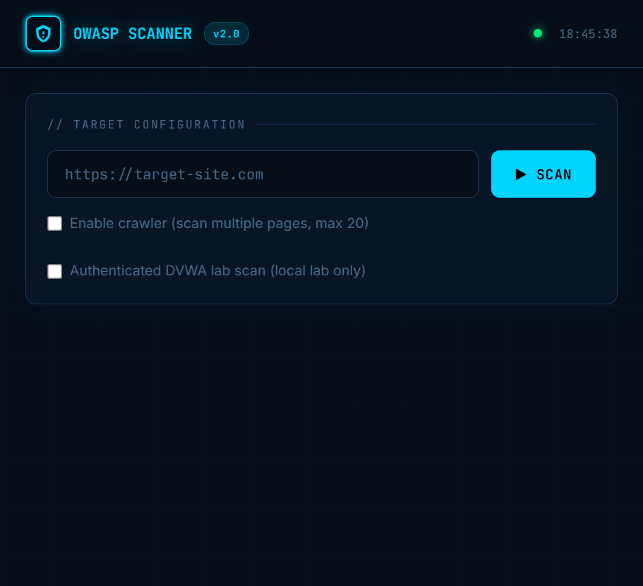
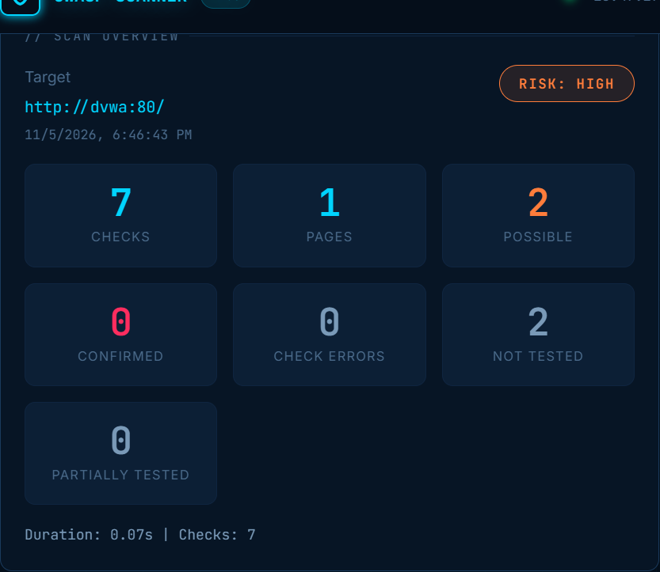
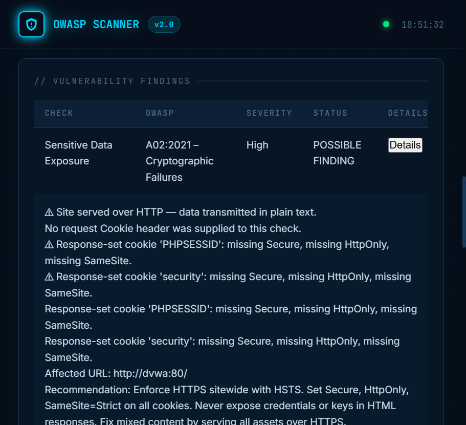
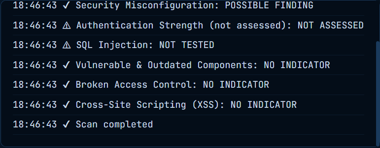
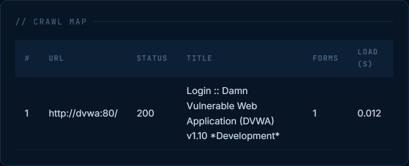
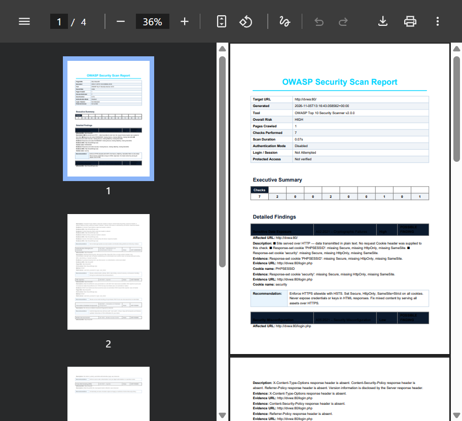

# OWASP Top 10 Security Scanner

A Python and Flask portfolio project that performs a small set of heuristic HTTP security checks, crawls authorized targets, and produces JSON and PDF reports. It includes an isolated Docker Compose lab for testing against the deliberately vulnerable DVWA application.

This is an educational demonstration tool, not a penetration-testing framework, compliance product, or substitute for a professional security assessment. Findings are indicators that require manual verification; they are not confirmed vulnerabilities.

## Features

- Flask dashboard and JSON API for submitting scans and exporting reports.
- Environment-configured administrator login, signed sessions, CSRF protection, and login throttling.
- Exact HTTP(S) origin allowlisting by scheme, hostname, and port; scans are disabled if the allowlist is empty.
- Seven check types covering selected indicators in five OWASP Top 10:2021 categories.
- Optional same-host crawl, capped at 20 unique pages.
- GET query and GET form input checks; forms are discovered without retaining entered field values.
- POST vulnerability forms are recorded as candidates but are never submitted.
- DNS-pinned HTTP requests, restricted-address validation, redirect/scope checks, request timeouts, response-size limits, and bounded concurrency.
- JSON and PDF reports with a plain-text fallback if PDF generation is unavailable.
- Opt-in authenticated session establishment restricted to the configured DVWA lab target.
- Automated tests using mocks and Flask's test client; tests do not scan public websites.
- Docker image runs as a non-root user and has a standard-library health check.

## Technology

- Python 3.10+
- Flask, Requests, Beautiful Soup
- Gunicorn
- ReportLab
- HTML, CSS, JavaScript
- Docker and Docker Compose
- pytest for tests

## Project structure

```text
.
├── app.py                  # Flask dashboard routes and JSON API
├── scanner.py              # URL safety, crawler, and security checks
├── report.py               # JSON normalization, PDF, and text reports
├── requirements.txt        # Runtime Python dependencies
├── Dockerfile              # Multi-stage, non-root application image
├── docker-compose.yml      # Loopback-only scanner service
├── docker-compose.dvwa.yml # Optional isolated DVWA lab override
├── nginx-lab.conf          # Fixed local-only lab gateway routes
├── .dockerignore           # Excludes local/generated files from image builds
├── .gitignore              # Excludes local configuration and generated files
├── templates/
│   ├── index.html          # Authenticated dashboard and client-side behavior
│   └── login.html          # Administrator sign-in
├── screenshots/            # Portfolio screenshots of the local DVWA demo
└── tests/
    ├── conftest.py
    ├── test_app.py
    ├── test_report.py
    └── test_scanner_safety.py
```

The local `.env`, logs, virtual environments, caches, and generated reports are intentionally not part of the project tree published to GitHub.

## Architecture

1. The dashboard submits a JSON request to Flask.
2. Flask requires an authenticated administrator session for the dashboard, scans, and report exports; login and state-changing requests use CSRF protection.
3. The scanner accepts only explicitly configured origins, validates DNS destinations, and connects to a validated address. Redirects and crawl links remain within the exact approved origin.
4. The optional crawler discovers same-host pages up to the configured page cap. It does not render JavaScript.
5. Independent checks run concurrently. SQL injection and XSS checks aggregate their results across crawled pages.
6. The scanner returns findings and crawl metadata. `report.py` normalizes report statuses and creates JSON/PDF or text output.
7. The dashboard renders the result and exports the already generated report; downloading a report does not start another scan.

The local Flask development server binds to `127.0.0.1`. The default Docker Compose service publishes on loopback only. The optional lab uses a Docker-internal network; a fixed-route gateway exposes the dashboard and DVWA UI only on loopback.

## OWASP Top 10:2021 coverage

Coverage is deliberately partial. A category listed as supported below means only that the scanner checks selected response indicators; it does not mean the category is comprehensively tested.

| Category | Current status | What the scanner checks and does not check |
|---|---|---|
| A01 Broken Access Control | Partial heuristic checks | Compares responses from a small set of conventional administrative routes. It cannot verify user roles, ownership, or object-level authorization. |
| A02 Cryptographic Failures | Partial indicators | Checks HTTP versus HTTPS, selected cookie flags, mixed content, and sensitive-looking response patterns. It is not a cryptographic or TLS configuration audit. Request cookie names and response-set cookies are distinguished; values are not reported. |
| A03 Injection | Partial checks | Uses non-destructive quote markers for available query and GET-form inputs and an inert marker for reflection. POST vulnerability forms are discovered but not submitted. Reflection does not test JavaScript execution. |
| A04 Insecure Design | Not assessed | No design or threat-model assessment is performed. |
| A05 Security Misconfiguration | Partial indicators | Checks selected security headers and visible server/version/debug or directory-listing disclosures. |
| A06 Vulnerable and Outdated Components | Partial fingerprinting | Looks for visible technology/version patterns. It does not confirm installed versions or perform a complete vulnerability-database match. |
| A07 Identification and Authentication Failures | Discovery only; authentication controls not assessed | Can report discovery of a password-bearing login form. Optional DVWA login is only used to establish a lab scan session; it does not test password policy, MFA, lockout, or session security. |
| A08 Software and Data Integrity Failures | Not assessed | No integrity, update, or supply-chain validation is performed. |
| A09 Security Logging and Monitoring Failures | Not assessed | Internal logging and alerting cannot be assessed from these HTTP checks. |
| A10 Server-Side Request Forgery | Not assessed | No SSRF payload testing is performed. Outbound scan requests are instead restricted by URL and address safety controls. |

### Understanding result statuses

- **Tested / no indicator:** the applicable check ran against the inputs or responses described in the report and did not observe its selected signal. This does not show that the target is secure.
- **Partially tested:** some safe input classes were checked, while other classes were intentionally omitted. For example, SQL injection can be partially tested when GET inputs are checked but discovered POST forms are left untouched.
- **Discovery only:** the scanner identified a surface, such as a login form, without testing the underlying security controls. A07 authentication strength remains unassessed.
- **Not assessed / unsupported:** the scanner does not implement a meaningful check for that security property, or the available inputs were insufficient to run one.
- **Possible finding:** a heuristic signal was observed and requires manual verification. The scanner does not treat response differences, an inert marker reflection, or a missing header by itself as proof of exploitability.
- **Confirmed finding:** the report format can represent this status, but the current heuristic checks do not confirm vulnerabilities.

## Requirements

- Windows 10/11 with PowerShell for the commands below.
- Python 3.10 or later for local execution.
- Docker Desktop with Docker Compose v2 for container or DVWA lab execution.
- Compose v2.24 or newer for the optional lab override syntax.

## Install and run on Windows

From the project directory in PowerShell:

```powershell
py -m venv .venv
.\.venv\Scripts\Activate.ps1
python -m pip install -r requirements.txt
$env:SECRET_KEY = python -c "import secrets; print(secrets.token_urlsafe(48))"
$env:SCANNER_ADMIN_USERNAME = Read-Host "Administrator username"
$env:SCANNER_ADMIN_PASSWORD_HASH = python -c "from getpass import getpass; from werkzeug.security import generate_password_hash; print(generate_password_hash(getpass(), method='scrypt:32768:8:1', salt_length=16))"
$env:SCANNER_ALLOWED_TARGETS = Read-Host "Exact authorized origin(s), comma-separated"
$env:SCANNER_ENV = "development"
$env:SCANNER_COOKIE_SECURE = "false"
python app.py
```

The password prompt is hidden; store only the resulting hash in `SCANNER_ADMIN_PASSWORD_HASH`. Enter exact origins such as `https://host-you-control:443`, not wildcards or paths. The `SCANNER_COOKIE_SECURE=false` setting is accepted only with `SCANNER_ENV=development` for this local HTTP server; never use it on a hosted service. Clear these process environment variables when you finish.

Open <http://127.0.0.1:5000>, sign in, and stop the development server with `Ctrl+C`.

Only scan applications you own or have explicit permission to assess. The default scanner rejects localhost, private, reserved, and non-routable destinations. Do not try to bypass those restrictions.

## Run with Docker

The default Compose configuration starts only the scanner and publishes it on loopback. Set the required authentication and exact-target environment variables in the current PowerShell session first, using the instructions above; for this local HTTP-only Compose setup, also set `SCANNER_ENV=development` and `SCANNER_COOKIE_SECURE=false`.

```powershell
docker compose up --build -d
docker compose ps
docker compose logs --tail 50 owasp-scanner
```

Open <http://127.0.0.1:5000>. The image health check uses Python's standard library and does not require `curl`.

Stop the service with:

```powershell
docker compose down
```

To build the image without starting the service:

```powershell
docker build -t owasp-scanner:local .
```

## Public deployment on Render

The public service requires application authentication and a non-empty exact-origin allowlist. It must not be deployed with missing, placeholder, or overly broad target entries. Only list HTTP(S) origins for systems you own or are explicitly authorized to assess. The scanner still blocks localhost, private, reserved, and non-routable destinations and pins validated DNS results when connecting.

Generate the Flask signing key and administrator password hash locally; do not commit either value:

```powershell
python -c "import secrets; print(secrets.token_urlsafe(48))"
python -c "from getpass import getpass; from werkzeug.security import generate_password_hash; print(generate_password_hash(getpass(), method='scrypt:32768:8:1', salt_length=16))"
```

The second command prompts without echoing the password and prints only its scrypt hash. Paste the generated values directly into Render's environment settings. Do not use a raw password as an environment variable or store these values in source control.

Create a Render **Web Service** with these settings:

| Setting | Value |
|---|---|
| Service type | **Web Service** |
| Repository / branch | This repository / `main` |
| Runtime | **Docker** |
| Root Directory | Leave blank (repository root) |
| Dockerfile Path | `Dockerfile` |
| Docker Command | Leave blank; use the Dockerfile `CMD` |
| Health check path | `/health` |
| Instance count | One instance until a shared rate-limit backend is configured |
| Auto-Deploy | **No** for initial review; deploy manually after reviewing the public configuration |

Set these service environment variables in the Render Dashboard:

| Variable | Required value |
|---|---|
| `PORT` | `10000` |
| `SCANNER_ENV` | `production` |
| `SCANNER_COOKIE_SECURE` | `true` |
| `SECRET_KEY` | Generated high-entropy signing key (at least 32 bytes) |
| `SCANNER_ADMIN_USERNAME` | Your administrator username |
| `SCANNER_ADMIN_PASSWORD_HASH` | Generated Werkzeug scrypt hash |
| `SCANNER_ALLOWED_TARGETS` | Comma-separated exact origins, each including scheme and port, e.g. enter only origins you control |

For example, the allowlist syntax is `https://your-owned-host.example:443`; replace the placeholder with your own authorized host. Entries cannot include wildcards, paths, credentials, or implicit ports. An absent or empty allowlist disables scanning. Every request and redirect is revalidated against the exact configured scheme, hostname, and port.

Render terminates HTTPS in front of the container. Keep `SCANNER_COOKIE_SECURE=true` so the administrator session cookie is Secure, HttpOnly, and SameSite=Lax. The health endpoint is public and reveals only service status/version; login, static assets, and health are the only unauthenticated surfaces. Dashboard, scan, and report-export routes require a logged-in administrator; all POSTs require CSRF tokens.

Login attempts are rate-limited with a local SQLite database. Limits are shared between workers on one instance but are not shared across Render instances and the database is ephemeral. Keep a single instance unless you add a shared rate-limit store; consider additional edge-level rate limiting because the account-wide limit can temporarily lock out legitimate sign-in attempts.

Do not set `SCANNER_COOKIE_SECURE=false` on Render, do not configure `SCANNER_LOCAL_LAB_*` variables, and do not deploy the DVWA container publicly. Reports are generated in memory and streamed; no report directory or persistent disk is required. Render deployment is not performed by this project.

## Run the isolated DVWA lab

The lab override allows scanner access only to the configured DVWA origin and pinned address, and only when `SCANNER_ENV=development`. Do not use this exception for other targets or enable it in production. The private subnet and addresses are supplied locally through an ignored `.env` file and must not be committed.

Create `.env` in the project directory with an unused private subnet and distinct scanner and DVWA addresses inside it:

```text
SCANNER_LOCAL_LAB_SUBNET=<unused private subnet in CIDR notation>
SCANNER_CONTAINER_IP=<scanner address inside that subnet>
SCANNER_LOCAL_LAB_IP=<DVWA address inside that subnet>
```

Do not put credentials in this file. Keep `.env` local; the repository ignore rules exclude it.

Validate and start the lab:

```powershell
$env:SCANNER_ALLOWED_TARGETS = "http://dvwa:80"
$env:SCANNER_ENV = "development"
$env:SCANNER_COOKIE_SECURE = "false"
docker compose -f docker-compose.yml -f docker-compose.dvwa.yml config -q
docker compose -f docker-compose.yml -f docker-compose.dvwa.yml up --build -d
docker compose -f docker-compose.yml -f docker-compose.dvwa.yml ps
```

Use these commands only in the same local PowerShell session where administrator authentication variables have been configured. The development-only setting is required for the pinned private DVWA exception and must not be used in production. Open DVWA at <http://127.0.0.1:8080> and complete its local database setup if prompted. The dashboard is at <http://127.0.0.1:5000>. The scanner and DVWA containers are not directly published to the host; the gateway has fixed routes and loopback-only ports.

To stop the lab:

```powershell
docker compose -f docker-compose.yml -f docker-compose.dvwa.yml down
```

### Optional authenticated DVWA session

Select **Authenticated DVWA lab scan** in the dashboard and enter your DVWA credentials there. Authentication is available only when the lab override enables it and only for the exact configured DVWA target. Credentials are used to establish a session and are not written to reports or application logs. Authentication success and protected-page verification are reported separately; neither means that authentication controls have been assessed. Do not paste credentials into chat, source files, URLs, or reports.

The scanner does not submit POST vulnerability forms, execute JavaScript, perform destructive database operations, modify files, or test login strength. GET probes are limited to the documented non-destructive markers.

## Run a scan

1. Confirm written authorization and the exact target scope.
2. Start the dashboard locally or with the default Docker Compose configuration.
3. Enter an absolute HTTP(S) URL that is permitted by the scanner's address and scope validation. For the isolated lab, use the configured DVWA service URL from the dashboard.
4. Enable crawling only when needed; the crawler is capped at 20 unique pages and follows same-host links.
5. Start the scan and review each check's status, evidence, and limitations. Treat possible findings as leads for manual validation, not as confirmed vulnerabilities.

The scan request runs synchronously. The dashboard receives results when it completes; crawl progress is not streamed.

## Reports and API

After a scan, use **Download JSON** or **Download PDF Report**. These buttons export the report returned by the scan and do not rescan the target. JSON contains the normalized report structure. PDF is generated with ReportLab; the API can return a plain-text `.txt` fallback if ReportLab is unavailable.

| Method | Path | Purpose |
|---|---|---|
| `GET` | `/login` | Public administrator sign-in form |
| `POST` | `/login` | Verify configured admin credentials (CSRF protected and rate limited) |
| `GET` | `/` | Authenticated dashboard |
| `GET` | `/health` | Public health and version status |
| `POST` | `/logout` | Authenticated logout (CSRF protected) |
| `POST` | `/scan` | Authenticated, CSRF-protected scan request |
| `POST` | `/export/json` | Authenticated export (or compatibility scan request) |
| `POST` | `/export/pdf` | Authenticated export (or compatibility scan request) |
| `POST` | `/export` | Authenticated legacy alias for JSON export |

Example request shape for an authorized target:

```json
{
  "url": "https://your-authorized-target.example:443",
  "crawl": false
}
```

The example domain is a placeholder, not a configured target. Set `SCANNER_ALLOWED_TARGETS` to exact origins you control, including scheme and explicit port. A scan URL must match an allowlisted scheme, hostname, and port and resolve only to globally routable addresses, except for the exact configured and pinned DVWA lab origin. Redirects must stay on the original origin. Requests are limited to 2 MB; new scans are rejected when both local scan slots are in use.

The authenticated export endpoints accept `{ "report": <report object returned by /scan> }`. For compatibility, they can also accept a scan request and perform a new scan; those requests are subject to the same allowlist and SSRF checks. Browser/API POST requests must include the CSRF token from the authenticated dashboard session.

## Automated tests

Tests use mocks or Flask's test client and do not scan public websites. `pytest` is a development/test dependency and is not included in the runtime requirements file.

```powershell
python -m pip install pytest
python -m pytest -q
```

Last validated for the authentication and allowlist update: **76 passed**, with two dependency/deprecation warnings. Test results may vary with later code or dependency changes.

## Screenshots

These screenshots document a genuine, unauthenticated-to-DVWA scan of the isolated local lab from before application sign-in was added. The scan reported **2 possible indicators and 0 confirmed vulnerabilities**. SQL Injection was **NOT TESTED**, and authentication strength (A07) was **NOT ASSESSED**. The indicators are heuristic results, not proof of exploitable vulnerabilities; the screenshots do not show the current login flow.

### Dashboard before scanning



The initial dashboard with no scan results loaded.

### Completed scan summary



Actual result counts from the local scan, including possible and confirmed findings.

### Findings and evidence



Example evidence for a possible indicator, including affected URL and remediation guidance. No JavaScript execution or vulnerability confirmation is implied.

### Live scan log



Check statuses from the completed scan, including checks that were not assessed or tested.

### Crawl map



The page discovered during this unauthenticated crawl; this is not authenticated DVWA module coverage.

### PDF report



The actual PDF report generated for the same local scan.

## Limitations

- Checks are deliberately limited, heuristic, and not comprehensive OWASP category assessments.
- A negative result does not prove that a target is secure; possible indicators need authorized manual validation.
- A01 cannot verify roles or object-level authorization. A02 is not a cryptographic/TLS audit. A06 fingerprints may be incomplete or stale.
- A03 does not submit POST vulnerability forms or execute JavaScript. Some checks may be partial when only selected input types were available.
- A07 authentication controls are not tested. Optional lab authentication only establishes and verifies a scan session.
- A04, A08, A09, and A10 are not assessed.
- The crawler does not render JavaScript and has a page cap but no configurable crawl-depth limit.
- The configured HTTP timeout limits socket inactivity, not total elapsed request time; a slow-drip response can occupy a worker.
- Scans are synchronous and there is no job queue or multi-instance coordination. The local SQLite login limiter is not shared across service replicas; keep one instance unless a shared backend and coordinated rate limiting are added.
- The scanner has one configured administrator identity; it does not provide user management, roles, password reset, or MFA. Apply additional edge-level rate limiting and protect the administrator credentials.
- Private destinations are rejected by default. The DVWA exception depends on the isolated Docker network and configured pinned service address; it is not general private-network scanning.

## Ethical and authorized use

Use this project only against systems you own or are explicitly authorized to assess. Obtain written authorization, follow the approved scope and rate limits, and stop if authorization is withdrawn. Do not scan public or third-party targets without explicit permission. The operator is responsible for lawful and safe use.
